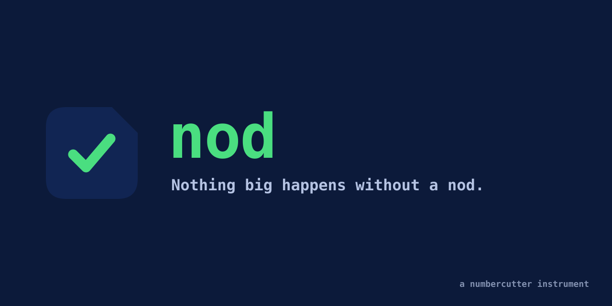

<p align="center"></p>

**Nothing big happens without a nod.**

nod holds a risky agent action until a person approves it, then runs it once. Requests live in SQLite, so the agent can crash, restart or hand off to another process, and the approval and the "already done" record are still there.

## Quick start

Needs [Bun](https://bun.sh) 1.1 or newer. No accounts, no API keys.

```sh
git clone https://github.com/numbercutter/nod && cd nod
bun examples/request.ts                       # process A asks for a $50k purchase order, then exits
bun src/cli.ts approve $(cat examples/.last-id)
bun examples/execute.ts                       # process B, fresh: sees the approval, places the order
bun examples/execute.ts                       # run it again: nothing happens twice
```

```
decision: approved by cli:you
placing order: 400 x ENC-220-AL from Halden Metals, $50000
done, PO-42AFE8
orders.log has 1 line(s)
...
decision: approved by cli:you
already executed earlier (PO-42AFE8), not running again
orders.log has 1 line(s)
```

To approve in a browser instead, run `bun src/cli.ts serve` in another terminal before `examples/request.ts` and open the link it prints.

Two more examples run offline with nothing to set up:

```sh
bun examples/two-approvers.ts   # 2-of-2 policy, approver list, reasons, auto-deny on expiry
bun examples/slack.ts           # Block Kit buttons against a local fake Slack, signed and forged presses
```

```
1. a $48,000 wire
  sam approves                     -> pending (1/2)
  sam approves again               -> refused: already_voted
  kim approves (not on this rule)  -> refused: not_an_approver
  lee approves via own link        -> approved (2/2)
  decided by sam, lee
  reason: matches PO-1182 and the signed quote / vendor bank details verified by phone
```

## Usage

```ts
import { Nod } from "@numbercutter/nod";

const nod = new Nod({ path: "nod.db" });

const { id, link } = await nod.request({
  action: "purchase_order.create",
  summary: "Order 400 aluminium enclosures from Halden Metals",
  amount: 50_000,
  payload: { vendor: "Halden Metals", sku: "ENC-220-AL", quantity: 400 },
  expiresIn: "2d",
});

const status = await nod.waitFor(id);          // "approved" | "denied" | "expired"
const { decidedBy, reason } = nod.get(id)!;

if (status === "approved") {
  const outcome = await nod.run(id, async ({ idempotencyKey, payload }) => {
    return placeOrder(payload, { idempotencyKey });
  });
  // outcome.ran is false if this request already ran, with the stored result
}
```

`expiresIn` takes seconds or `30m`, `4h`, `2d` (default 24h). The function you pass to `run` gets the payload, the amount and a stable `idempotencyKey`; pass that key to the API you call.

`nod.approve(id, { by, reason })` and `nod.deny(id, { by, reason })` record a decision with optional reason text. Every vote is kept with its approver, reason and time; `get(id).votes` lists them and `get(id).reason` joins the reasons behind the final decision.

### Policies

Put rules in `nod.config.json` (or `$NOD_CONFIG`, or pass `config` to `new Nod`). The first rule whose `action` and `minAmount` match a request sets its policy; top-level fields are the default. A policy is copied onto the request when it is created, so editing the file later does not change requests already waiting.

```json
{
  "approvers": ["sam", "lee", "kim"],
  "onExpiry": "denied",
  "rules": [
    { "action": "payment.*", "minAmount": 10000, "approvals": 2, "approvers": ["sam", "lee"] }
  ]
}
```

| field | meaning |
|---|---|
| `action` | exact action, or a prefix ending in `*` |
| `minAmount` | rule applies when `amount` is at least this |
| `approvals` | distinct approvers needed (default 1); one deny ends the request |
| `approvers` | only these names may decide; each gets a personal link |
| `onExpiry` | `expired` (default) or `denied` when time runs out without enough approvals |

With an approver list, `request` returns `links` keyed by approver instead of one shared `link`, and each link records its owner's name. Slack users are matched as `slack:<username>` or `slack:<user id>`.

### Approvers

- **Browser.** `nod serve` serves `GET /r/:id?t=<token>` with the summary, amount, payload, votes so far, a reason box and Approve / Deny buttons. The token is single use and only its hash is stored. Opening the link does not decide anything, so link previews are harmless.
- **Slack buttons.** Set `NOD_SLACK_BOT_TOKEN` (a bot with `chat:write`) and `NOD_SLACK_CHANNEL`, and each new request is posted as a Block Kit message with Approve and Deny buttons. Point the Slack app's Interactivity request URL at `https://<your host>/slack/actions` and set `NOD_SLACK_SIGNING_SECRET`. nod checks the `v0` HMAC signature and refuses timestamps more than 5 minutes off, records the vote as `slack:<username>`, then rewrites the message with the votes so far and drops the buttons once decided. Refusals (not an approver, already voted) come back as an ephemeral reply. While `nod serve` runs, requests that expire are rewritten too.
- **Slack link.** Set `NOD_SLACK_WEBHOOK` to an incoming webhook URL and each new request posts its summary and link there. With an approver list the shared link is left out.
- **CLI.** Anyone with access to the database file can decide.

```sh
bun src/cli.ts serve --port 4747     # set NOD_URL if links should use another address
bun src/cli.ts list                  # pending, and approved but not run yet
bun src/cli.ts list --all
bun src/cli.ts show <id>
bun src/cli.ts approve <id> --by sam --reason "matches the quote"
bun src/cli.ts deny <id> --by sam --reason "already paid"
bun src/cli.ts link <id>             # fresh one-time link if the first one is lost
bun src/cli.ts link <id> --for lee   # fresh personal link when the request has an approver list
```

| env | default | |
|---|---|---|
| `NOD_DB` | `nod.db` | database file |
| `NOD_URL` | `http://127.0.0.1:4747` | base for approval links |
| `NOD_CONFIG` | `nod.config.json` | policy file |
| `NOD_SLACK_BOT_TOKEN` | unset | bot token for Block Kit messages |
| `NOD_SLACK_CHANNEL` | unset | channel id or name to post in |
| `NOD_SLACK_SIGNING_SECRET` | unset | verifies `/slack/actions`; without it the route answers 404 |
| `NOD_SLACK_API` | `https://slack.com/api` | Slack Web API base, for a local stand-in |
| `NOD_SLACK_WEBHOOK` | unset | Slack incoming webhook |

## How it works

Each request is one SQLite row: status, policy, expiry, an idempotency key, an `executed` flag and the stored result. Votes sit in their own table keyed by request and approver, so one person counts once; hashed one-time link tokens sit in another. A vote and the status change it causes happen inside one immediate transaction, so two approvers racing cannot both complete or overwrite a deny. Databases from 0.1 gain the new columns and keep their open links on first open.

`run` claims the row with a conditional update before calling your function, marks it executed with the result afterwards, and releases the claim if your function throws. A second caller, in any process, gets the stored result instead of a second run. If a process dies inside your function, the claim is retried after a lease (60 s by default) with the same idempotency key and `attempt` incremented.

## Limits

- Exactly once is guaranteed for nod's own record, not for the outside world. If a process dies after the external call but before nod records it, the retry calls again with the same idempotency key. The API you call has to honour that key.
- Single machine. SQLite in WAL mode handles several local processes; it is not a shared store across hosts.
- Approval links carry their token in the URL. Anyone holding a link can decide, under that link's approver name, until it is used or expires.
- Approver names are only as strong as the channel they come from. The CLI trusts `--by` from anyone with the database file; Slack names come from Slack's signed payload.
- `nod serve` has no login. It binds to `127.0.0.1`; `/slack/actions` needs to be reachable by Slack, so put a proxy in front that exposes only that path.
- A signed Slack request can be replayed within its 5-minute window. A replay cannot add a second vote for the same person, but nod keeps no record of seen signatures.
- Slack buttons carry no reason text; reasons come from the CLI, the web page or the library.
- `waitFor` polls the database (500 ms by default) rather than being pushed.
- Slack messages and updates are sent once, without retries. A failed update leaves the old buttons in place; pressing them still gets a correct answer.

## Works with

[leash](https://github.com/numbercutter/leash): once a request is approved, mint the short-lived, scoped token the agent uses to carry it out.

<sub>A numbercutter instrument · MIT</sub>
